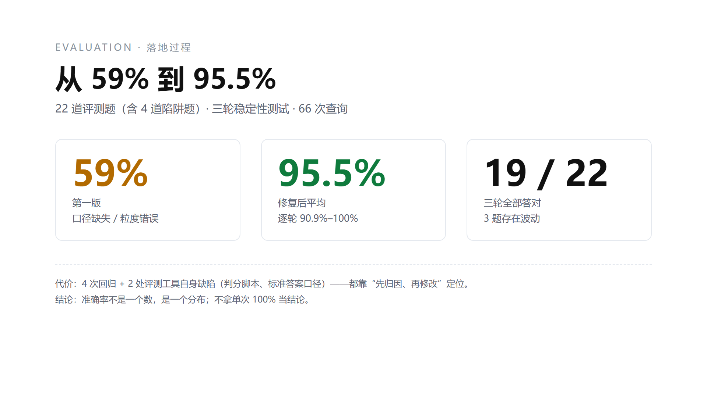

# AI 智能问数系统（Text-to-SQL / ChatBI）

> 用自然语言问数据库，自动生成 SQL 并出图表。
> 这个仓库的重点不是"能答"，而是**怎么证明它答得对**——含 22 道评测题、自动化跑分脚本与三轮稳定性报告。

🎬 **演示视频**：https://www.bilibili.com/video/BV1CuWt6VEn5/



---

## 一、结果

| 指标 | 数值 |
|---|---|
| 数据规模 | 8 张表 / **99,421** 笔订单 / 112,649 条商品明细 |
| 评测集 | **22 道题**（含 4 道陷阱题：重复计数、空值、状态过滤） |
| 准确率 | **95.5%**（三轮共 66 次查询） |
| 逐轮表现 | 100% → 95.5% → 90.9% |
| 稳定性 | **19/22 题三轮全对**，3 题存在波动 |
| 提升幅度 | 首版 59% → 修复后 95.5% |

> 注意：**这里报的是平均数与分布，不是单次最好成绩**。单次跑到 100% 不作为结论。

---

## 二、这个项目在做什么

企业里的数据大多躺在数据库里，业务方不会写 SQL，分析师又排队。
Text-to-SQL 想解决的就是这件事，但难点不在"生成一条 SQL"，而在：

1. **口径歧义**——"销售额"要不要算取消订单？含不含运费？
2. **粒度错误**——"平均运费"是按订单算，还是按商品明细算？
3. **越界生成**——问"卖出多少件"，它可能答成"多少单"；
4. **不可验证**——没人知道它答得对不对。

所以本项目把重心放在**评测与口径治理**上。

---

## 三、系统结构

```
用户提问
   │
   ├─ ① 语义理解 / 意图识别
   ├─ ② Schema 召回（表结构 + 中文注释）
   ├─ ③ 业务口径注入（术语库 + SQL 示例 few-shot）
   ├─ ④ 生成 SQL
   ├─ ⑤ 执行并返回结果 / 图表
   └─ ⑥ 记录 SQL 与耗时，供评测回放
```

数据侧做了三件事：

- 为 8 张表、60+ 字段补齐**中文注释**，让中文提问能映射到英文字段；
- 规范字段类型（金额 `decimal(10,2)`、时间 `datetime`），否则 SUM/AVG 会算错；
- 修正原始数据集里的拼写错误字段（`product_name_lenght` → `product_name_length`）。

---

## 四、评测怎么做（本仓库的核心）

### 1. 题库设计

`eval/nl2sql_cases_v2.jsonl`，22 道题，每题包含：

| 字段 | 说明 |
|---|---|
| `question` | 题干（**写死口径**：状态范围、时间范围、分母、是否含运费） |
| `sql` | 标准 SQL |
| `expected` | 由标准 SQL 在库中实际执行得到的答案 |
| `alts` | **另一种合理解读**及其答案（用于证明题干存在歧义） |

### 2. 为什么要写 `alts`

同一句话的两种合理解读，答案可能差 15 倍。例如：

| 题目 | 标准口径 | 另一种解读 | 差距 |
|---|---|---|---|
| 各支付方式订单数 | 4,963（仅 10 月） | 76,505（全部历史） | 15 倍 |
| 总支付金额 | 16,003,842.91（全部状态） | 15,422,461.77（仅已交付） | 58 万 |
| 平均每单运费 | 23.13（按订单） | 20.57（按明细行） | 11% |

**有了 `alts`，才能判断"模型答错"到底是模型的问题，还是题干的问题。**

### 3. 陷阱题

| 编号 | 陷阱 | 标准答案 | 常见错法 |
|---|---|---|---|
| T01 | 卖出多少**件**商品 | 112,649 | 答成订单数（约 9.9 万） |
| T02 | 总支付金额 | 16,003,842.91 | 先 JOIN 订单表再 SUM，**翻倍** |
| T03 | 品类未知的商品数 | 610 | 用 `=''` 查，返回 0 |
| T04 | 含取消订单的销售额 | 854,686.33 | 误加 delivered 过滤，答成 838,576.64 |

### 4. 自动化跑分

`scripts/run_eval_api.py`：

```
登录 → 逐题开新会话 → 读取 SSE 流（拿 SQL）→ 取查询结果 → 与标准答案比对 → 输出 Excel
```

`scripts/run_stability.py`：跑 3 轮，输出逐题稳定性与方差。

---

## 五、发现的四个问题（真实记录）

| 类型 | 现象 | 根因 | 修法 |
|---|---|---|---|
| 口径缺失 | 销售额虚高 1.6 万 | 未过滤 `order_status='delivered'` | 术语库固化"销售额"定义 |
| 粒度错误 | 平均运费 20.57 vs 23.13 | `AVG(freight_value)` 按明细行算 | 术语库规定"平均类指标分母用订单数" |
| 回归 | Q14 SQL 报 1055 错误 | `GROUP BY` 与 `SELECT` 用了不同客户字段 | 补充"客户统计口径"术语 |
| **评测工具自身** | 4 条正确答案被判错 | 判分脚本 `float("14.68%")` 抛异常 | 修判分逻辑，支持百分号/千分位 |

> 最后一条最重要：**测量系统也要被测量**。如果不查，我会拿错误的分数去改模型。

---

## 六、快速开始

### 依赖

- Docker
- Python 3.10+
- DeepSeek API Key（或任何 OpenAI 兼容模型）

### 1. 起数据库并导入数据

```bash
docker run -d --name nl2sql-dw \
  -p 13306:3306 \
  -e MYSQL_ROOT_PASSWORD=changeme \
  -v nl2sql-data:/var/lib/mysql \
  mysql:8.0.45 --character-set-server=utf8mb4
```

把 Olist 的 8 个 CSV 放到 `data/`，然后：

```bash
pip install pymysql openpyxl
export DB_PASSWORD=changeme
python scripts/load_olist.py
```

### 2. 启动问数系统（基于开源 SQLBot）

```bash
docker run -d --name sqlbot -p 8000:8000 --privileged=true dataease/sqlbot
```

浏览器打开 `http://localhost:8000`，配置数据源（主机填 `host.docker.internal`，端口 13306）。

### 3. 跑评测

```bash
export SQLBOT_PWD=<你的密码>
python scripts/run_eval_api.py     # 单轮，出报告
python scripts/run_stability.py    # 三轮稳定性
```

---

## 七、目录结构

```
.
├── docs/screenshots/          运行截图
├── eval/
│   ├── nl2sql_cases_v2.jsonl  22 道评测题（含标准 SQL、答案、备选解读）
│   ├── NL2SQL跑分报告_v2.xlsx  逐题结果
│   └── NL2SQL稳定性报告.xlsx    三轮稳定性
└── scripts/
    ├── load_olist.py          建表 + 导入 + 日期对齐
    ├── build_eval_v2.py       生成评测集（含备选解读）
    ├── run_eval_api.py        自动化跑分
    └── run_stability.py       稳定性测试
```

---

## 八、数据说明与已知限制

**数据来源**：巴西电商公开数据集 Olist（Kaggle），8 张表、约 10 万订单。

**日期平移**：原始数据为 2016–2018 年，为便于演示"上个月 / 最近三个月"这类相对时间查询，
将订单时间整体平移至 2024-11 ~ 2026-10（+8 年 2 个月），并剔除原始数据末尾 20 条稀疏订单。
**除时间字段外，数据未作任何修改。**

**已知限制**：

1. 单库单表场景，未验证多库/跨库 JOIN；
2. 术语与示例靠向量检索命中，命中与否有概率性，这是 3 道题波动的主因；
3. 评测集为自建，存在过拟合风险，尚未做留出集盲测；
4. 未做并发压测与成本曲线。

---

## 九、下一步

- [ ] 术语改为强制注入，降低检索随机性
- [ ] 评测集扩到 100 题，并引入留出集
- [ ] 加一次跑 5 轮的稳定性看板
- [ ] 接入 SQL 执行前的静态校验（防全表扫描、防 UPDATE）
